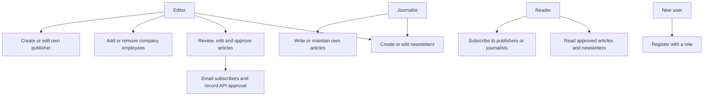
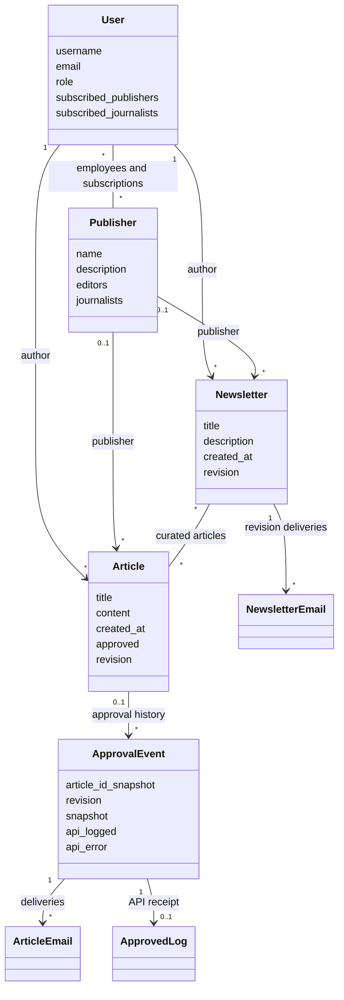

# News capstone design

## Requirements
Readers view approved articles/newsletters and subscribe to publishers/journalists.
Journalists create and maintain their own content. Editors review, approve, update and
delete within their permitted scope. Token-authenticated API clients can retrieve
approved and subscribed content. Failed requests return validation/permission errors.
Non-functional goals: clear role navigation, enforced ownership, CSRF protection,
password hashing, predictable pagination, atomic state changes and retryable delivery.

## Interface
Header links: home, newsletters, subscriptions for readers, workspace for contributors,
login/register/logout. Home lists approved articles; detail shows author/publisher/content.
Workspace provides editing, deletion confirmation and editorial approval actions.
Forms display field errors; mobile layout wraps navigation and stacks content cards.

## Normalised storage
User contains identity/role; Publisher contains publisher metadata. Separate many-to-many
join tables store publisher editors/journalists and reader subscriptions. Article stores
one author FK and optional publisher FK. Newsletter has one author, optional publisher,
and an article M:N join. No comma-separated article/subscription lists are stored.
ApprovalEvent captures an immutable revision snapshot for delivery auditing. ArticleEmail
has a unique (event, reader) pair; ApprovedLog has one event; NewsletterEmail has a unique
(newsletter, revision, reader) tuple. Deliberate snapshots retain historical delivery data.

## Approval flow
Editor request > permission checks > lock article > approve current revision > record
ApprovalEvent > commit > email delivery and Requests POST to own /api/approved/ endpoint.
Endpoint verifies the authenticated approving editor and event. Revision/event uniqueness
prevents duplicate integration logs; delivery rows track failures for retry.

## Security and failure recovery
Role groups receive explicit permissions. Registration supports reader, editor and
journalist roles, but never staff/superuser flags. Editor registration does not grant
membership of existing publishers. Editors create a publisher and become its first
editor; members with the editor role manage profiles and employees. Staff-management
views enforce company membership, CSRF and POST for removal. The final active editor
cannot be removed. Removed journalists lose access to company drafts and editing.
Independent stories are reviewable by editors, as required by the brief.
Only approved content is visible to ordinary readers. Object-level policy checks protect
publisher-owned and independent drafts. Credentials come from ignored .env files.
Invalid form preserves user input; missing records return 404; denied mutations return 403.
Delivery failure is recorded without losing approved content. Database transactions protect
approval state. Real email delivery and MariaDB deployment must be verified separately.


## Publisher onboarding and UI
The home page introduces the publishing workspace. Editors are directed to My
publishers after registration, journalists to Newsroom, readers to Latest news.
Publisher pages show editors and journalists, profile editing and employee management.
The employee form accepts an existing active account's username. It does not change
that person's role or credentials. All editors in a company can manage its employees.
No administration page is needed for onboarding or daily work. The navigation wraps
with visible spacing on narrow screens. The skip link is hidden offscreen until
keyboard focus and moves focus to the main content.

## Use case diagram


## Sequence diagram: onboard a company and publish
```mermaid
sequenceDiagram
    actor Editor
    participant Web as Django views/forms
    participant DB as Database
    actor Journalist
    participant Service as Approval service
    Editor->>Web: Register as editor
    Web->>DB: Save user; synchronise Editor group
    Editor->>Web: Create publisher profile
    Web->>DB: Save publisher and add editor membership atomically
    Journalist->>Web: Register as journalist
    Web->>DB: Save user; synchronise Journalist group
    Editor->>Web: Add employee by username
    Web->>DB: Check membership and employee role; add employee
    Journalist->>Web: Submit publisher article
    Web->>DB: Validate employment; save draft
    Editor->>Web: Approve article
    Web->>Service: Verify permission and approve
    Service->>DB: Lock article; save approval event and snapshot
    Service->>Service: Send subscriber emails and POST own API
    Service->>DB: Record delivery and API outcomes for retry
```

## Class diagram


The diagrams render directly in GitHub's Markdown viewer. Their editable sources
are also provided as separate `.mmd` files in this folder. Publisher memberships use
the existing many-to-many tables, so these workflow changes require no new migration.
